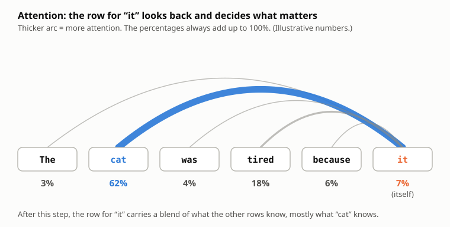

*This is part 2 of a series on how AI chat agents like ChatGPT, Claude and Gemini actually work, written by a backend engineer for backend engineers. [Part 1](/blog/what-an-llm-is-for-backend-engineers/) covered how text becomes tokens and tokens become vectors. This part covers what the model does with those vectors, and how it ends up choosing a token.*

Part 1 ended with a grid of numbers: one row per token, and `d_model` columns per row (4,096 in many models; think of R, G and B, but 4,096 of them). The shape is `[N, d_model]`.

But look at what that grid actually knows. Each row only knows its own token. The row for `bank` is identical in "river bank" and "bank account". No row knows anything about its neighbours.

That's a problem, because meaning depends on context. This part is about the trick that fixes it, and it's the heart of every modern LLM: **let the rows look at each other**. After that, we'll see how the model turns the result into one chosen token.

## Step 3: layers add context

### The problem, with an example

Take the prompt "The cat was tired because it". Straight out of the embedding table, each row knows only its own token:

```text
row  token       what this row knows
1    "The"       the word "The"
2    " cat"      the word "cat" (an animal)
3    " was"      the word "was"
4    " tired"    the word "tired"
5    " because"  the word "because"
6    " it"       the word "it" (a pronoun: it refers to something)
```

Row 6 knows it's a pronoun, but not what it refers to. Nothing in that row mentions the cat. In fact the row for `" it"` is the same in every sentence ever written, because it came from a fixed lookup table.

The model fixes this with a stack of **layers**. Here is how the knowledge in row 6 grows as the layers run (an illustration, so imagine the numbers translated into words):

| | what row 6 (`" it"`) knows |
| --- | --- |
| Before any layer | "it": a pronoun that refers to something |
| After a few layers | "it" refers to "cat", an animal |
| After many layers | "it" is the cat, who is tired. This clause explains *why*. A verb is probably coming next |

A caveat: real rows are 4,096 numbers, not sentences, and real models don't store tidy statements like these. The words are a translation of what the numbers roughly encode, the same way the "animal / pet / place / city" labels in part 1 were a translation of columns that don't actually have labels.

### One layer, two moves

Every layer does the same two things, in the same order:

1. **Look around.** Each row looks at the rows before it and pulls in what's relevant. This is called **attention**.
2. **Think alone.** Each row then processes what it has gathered, on its own. This is called the **feed-forward network**.


Notice that a layer takes a grid in and hands a grid back with exactly the same shape, `[N, d_model]`. That's what lets layers be stacked: the output of layer 1 is the input of layer 2, and so on, 32 or more times. The shape never changes, but the numbers do.

Later layers build on earlier ones. A layer can only use what the layers before it have already written into the rows, so a fact like "*it* is the cat" has to be established first before a later layer can use it to work out that the sentence is explaining why the cat is tired.

## Move 1: attention (look around)

### A fuzzy cache lookup

Row 6 needs to find the cat. As a backend engineer, you already know the shape of this problem: it's a **lookup**.

```text
exact lookup:   store["cat"]                        -> one value, or a miss
attention:      compare against every row's label   -> a blend of all values, weighted by how well each matched
```

A normal cache is exact: one key matches and you get its value, or you get nothing. Attention is the **fuzzy** version. Row 6 compares what it's looking for against *every* earlier row, closer matches count for more, and what comes back is a **blend** of what those rows have to offer. Here is what that might look like for row 6:



Most of the attention goes to `cat`, a good chunk to `tired`, and scraps to the rest. The percentages always add up to 100%. (These numbers are illustrative; real ones are learned, and they differ in every layer.)

### The blend is like mixing paint

What does "a blend" mean in numbers? Remember the colors from part 1: you can average two colors to get something in between. Blending rows works exactly the same way, just with 4,096 columns instead of 3.

Say row 2 (`cat`) contributes the color `[230, 30, 30]` and row 4 (`tired`) contributes `[30, 30, 230]`. To keep the arithmetic simple, ignore all the other rows and mix just those two, 75% / 25%:

```text
0.75 × [230, 30, 30]  +  0.25 × [30, 30, 230]  =  [180, 30, 80]
```

The result is mostly red, because most of the weight was on the red one. That's the idea. The blend leans toward whatever the row paid most attention to, and it gets added into row 6's own numbers. So after this step, row 6 carries a bit of "cat-ness".

### Who decides the percentages?

Each row writes two short notes about itself, and the match between them sets the percentage:

| Name | What it is | In our example |
| --- | --- | --- |
| **Query** | the search request: what I'm looking for | row 6: "I'm a pronoun. Which noun do I refer to?" |
| **Key** | the label: what I am | row 2: "I'm a noun, an animal, the subject" |
| **Value** | the payload: what I hand over if picked | row 2: "here is what I know about myself" |

Row 6's query matches row 2's key well, so row 2 gets a big percentage, and its value is what gets blended in. You'll see "query, key, value" in every paper about transformers; this is all they mean. Nobody writes these notes by hand. The model learns how to write them during training.

<details>
<summary>The same thing in code, if you want it</summary>

```python
def attend(i, rows):
    q = query(rows[i])                                                  # row i's search request
    scores = [dot(q, key(rows[j])) for j in range(i + 1)]               # how well does each earlier row's label match?
    weights = softmax(scores)                                           # turn scores into percentages that add up to 100%
    blend = sum(w * value(rows[j]) for j, w in enumerate(weights))      # weighted average of their payloads
    return rows[i] + blend                                              # add it to the row's own numbers
```

`query`, `key` and `value` are each a learned multiplication of the row's numbers. `dot` measures how well two lists of numbers line up (the idea behind cosine similarity in part 1). `softmax` is how scores become percentages, and we'll meet it again in Step 4.

</details>

### Three things worth knowing

- **Rows only look backward.** Row 6 can read rows 1 to 6 but not row 7. Text is produced left to right, so when the model is generating, the later words don't exist yet.
- **Many lookups run at once.** A real layer runs dozens of these lookups side by side (called **heads**). One might ask "which noun does this pronoun refer to?", another "what was the previous word?". Nobody assigns these jobs; they emerge during training.
- **Long prompts get expensive, fast.** Every row checks every earlier row, so doubling the length of the prompt roughly quadruples this part of the work. This is why very long contexts cost so much.

## Move 2: feed-forward (think alone)

After attention has pulled in new information, each row processes it **by itself**. It's the same procedure for every row, and rows don't look at each other here, so all the rows can be computed in parallel.

If attention is "gathering information", this is "making use of it": the row takes "it refers to the cat" and turns it into whatever follows from that. Most of the model's numbers (its parameters) live in this step. Researchers think a good share of what the model knows, such as "Paris is the capital of France", is stored here too, though that is still an active area of research.

## Stacking the layers

Put the two moves together and repeat them, and you have the whole model:

```python
def next_token_scores(token_ids):
    rows = embedding_table[token_ids]          # part 1: one row of numbers per token
    for layer in layers:                       # e.g. 32 layers
        rows = layer(rows)                     # attention, then feed-forward
    return scores_for_each_vocab_token(rows[-1])    # only the LAST row is used
```

Two details make this work:

- **Each layer adds to the rows; it doesn't replace them.** Nothing learned by an early layer is lost; later layers can still see it. You can picture each row as a document that every layer annotates a bit more.
- **Only the last row is used for the prediction.** During training, every row is used to predict the token that follows it. When generating, we only need the **last** one, because that's where the next token goes. By then, it holds everything the model worked out about the whole prompt.

A final step turns that last row into **one score for every token in the vocabulary**. These raw scores are called **logits**, so a 100,000-token vocabulary gives 100,000 scores. The next step turns them into a choice.

## Step 4: pick a token

We have a score for every possible next token. Two things must happen before we get a token: turn the scores into percentages, then choose.

### Scores to percentages

The scores can be any number, including negative, and they don't add up to anything. **Softmax** fixes that: make every score positive by exponentiating it (which also exaggerates the gaps), then divide by the total so they sum to 100%. Say the model gives three candidates the scores 4, 3 and 1:

```text
scores:         4.0     3.0     1.0
exp(score):    54.6    20.1     2.7        (sum = 77.4)
probability:   70.5%   25.9%    3.5%
```

### Choosing: greedy or weighted random

The simplest choice is **greedy**: always take the top token. It's deterministic, but the text tends to be bland and repetitive, and it can get stuck in loops, because the most likely continuation of a repeated phrase is usually to repeat it again.

So most systems **sample** instead: draw a random token *weighted by its percentage*. If you've used weighted random load balancing, it's exactly that, with tokens as the backends. With the numbers above, the first token is picked 70.5% of the time, the second 25.9% of the time, and the third now and then.

### Temperature: how adventurous to be

A knob called **temperature** (T) reshapes the percentages before you draw. Divide every score by T first:

```text
scores 4, 3, 1      top token   second     third
T = 0.5 (sharper)     87.9%     11.9%      0.2%
T = 1.0 (as-is)       70.5%     25.9%      3.5%
T = 2.0 (flatter)     54.7%     33.1%     12.2%
```

Low temperature makes the model stick to the safe choice, and as T approaches 0 you get greedy decoding. High temperature gives more varied text, and eventually incoherent text. A good rule of thumb: low T for code and data extraction, higher T for brainstorming and creative writing.

<details>
<summary>Going deeper: top-k, top-p and the full sample() function</summary>

With 100,000 candidates, the thousands of absurd tokens each have a minuscule probability, but together they can add up to a few percent. Sample often enough and a nonsense token will eventually get picked. And because every pick is fed back in as input for the next step, one bad token can derail the rest of the reply. So systems cut the tail off first:

- **Top-k** keeps only the k most likely tokens and renormalizes. With k = 2, only the two best survive.
- **Top-p** (nucleus sampling) keeps the smallest set of top tokens whose probabilities add up to at least p. Unlike a fixed k, it adapts: when the model is confident, only a couple of tokens survive, and when it's unsure, many do.

```text
probabilities:   50%   25%   12%    6%    4%    3%
cumulative:      50%   75%   87%   93%   97%  100%
top-k = 2  keeps:  [x]   [x]
top-p = 0.9 keeps: [x]   [x]   [x]   [x]       <- stops at 93%, the first total >= 90%
```

Put together, this is the `sample` step from the `generate` loop in part 1:

```python
import math, random

def sample(scores, temperature=1.0, top_p=0.9):
    if temperature == 0:
        return max(range(len(scores)), key=lambda i: scores[i])      # greedy

    scaled = [s / temperature for s in scores]                       # temperature
    exps = [math.exp(s - max(scaled)) for s in scaled]               # softmax (shifted for numerical stability)
    probs = [e / sum(exps) for e in exps]

    ranked = sorted(range(len(probs)), key=lambda i: -probs[i])      # top-p: keep the head of the distribution
    kept, total = [], 0.0
    for i in ranked:
        kept.append(i)
        total += probs[i]
        if total >= top_p:
            break

    return random.choices(kept, weights=[probs[i] for i in kept])[0] # weighted random draw
```

(For simplicity, the `generate` loop in part 1 showed the model returning probabilities. Real implementations keep the raw scores so that temperature can be applied before softmax, as above.)

</details>

### Why this matters to you as an engineer

This step is the only source of randomness in the whole system. Everything before it, from tokenizing to the last layer, is deterministic math. That's why the same prompt can give different answers on different runs, and why temperature 0 is *nearly* repeatable. Nearly, because in practice floating-point arithmetic on GPUs, combined with how requests get batched together, can still make results differ slightly between runs. It's also why testing an agent is hard: you can't assert on exact output, so you need evals that tolerate variation. We'll come back to that in the agents part.

## What this sets up for later

Three facts from this part come back again and again in the rest of the series:

1. **The weights are huge.** All the learned numbers (the embedding table from part 1, plus the matrices inside every layer) are called the model's **weights**, and they are read-only when serving. A 70-billion-parameter model stored in 16-bit precision needs about 140 GB for weights alone. That doesn't fit on one GPU, so serving it already means splitting the model across several of them. Welcome to distributed systems.
2. **A request has two very different phases.** In **prefill**, the model reads your whole prompt: all N rows go through the layers together, in parallel, which is compute-heavy and fast per token. In **decode**, it generates the answer one token at a time, and each step depends on the last, so it can't be parallelized and is limited by memory bandwidth (every new token has to read through essentially all the weights). Time to first token is mostly prefill; the speed at which text streams in afterwards is decode.
3. **Earlier rows never change, so we can cache them.** Because rows only look backward, the key and value of every earlier row stay exactly the same when a new token is appended. So when generating token N+1, nothing earlier needs to be recomputed: the model only builds the new token's own row, and looks things up against the saved keys and values of the earlier ones. That saved set is the **KV cache**. It saves a lot of compute but takes up a lot of GPU memory, and that trade-off is a big part of the inference post later in the series.

## What's next in the series

1. [**How an LLM sees text: tokens and vectors**](/blog/what-an-llm-is-for-backend-engineers/)
2. **How an LLM understands context: layers and attention** (this post)
3. **Anatomy of a chat request.** Chat templates, statelessness, context windows and prompt caching.
4. **LLM inference: serving is a scheduling problem.** KV cache, continuous batching, and why GPU memory is the scarce resource.
5. **Retrieval, tools and agents.** Why an agent is a distributed workflow with a flaky, non-deterministic step.
6. **Training at scale.** Distributed training as a fault-tolerance problem.

In part 3 we'll zoom out from the model to the product around it: what actually gets sent when you press enter in a chat window.
